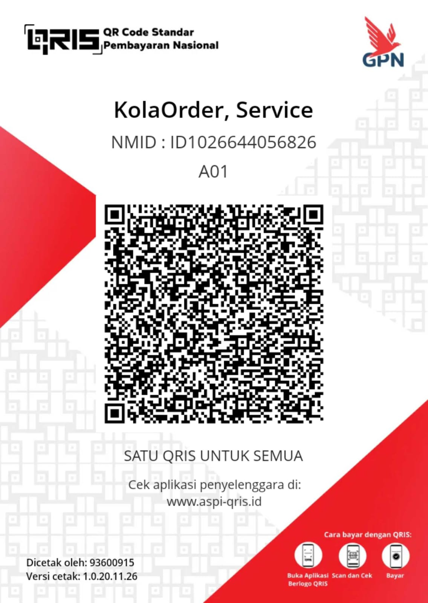

# KalaOrder — Kasir UMKM, Manajemen Keuangan & Bot WhatsApp 24 Jam

-3DDC84?logo=android&logoColor=white)


**KalaOrder** adalah aplikasi Android offline-first berbasis **Kotlin** dan **Jetpack Compose** yang dirancang khusus untuk membantu operasional harian UMKM kuliner, kedai kopi, warung makan, hingga toko rumahan di Indonesia.

Dibuat oleh **Alfa Tabi Mawarid**.

---

## Fitur Utama

### 1. Kasir POS & Antrean Dapur
- Alur status pesanan terstruktur: **Menunggu** → **Diproses** → **Selesai** atau **Dibatalkan**.
- Pembuatan pesanan manual langsung dari kasir dengan pilihan saluran (**Kasir** / **WhatsApp**).
- Otomatisasi pengurangan stok saat pesanan masuk dan pengembalian stok saat pesanan dibatalkan.
- Tampilan struk pesanan rapi yang bisa langsung dibagikan atau dijadikan bukti transaksi.

### 2. Bot Auto-Reply WhatsApp 24 Jam (Tanpa API Berbayar)
- Berjalan di latar belakang menggunakan `NotificationListenerService` + `ForegroundService` Keep-Alive sehingga tetap responsif meskipun layar HP mati.
- Mendukung pembalasan otomatis melalui *Direct Reply* notifikasi **WhatsApp** dan **WhatsApp Business**.
- Perintah otomatis untuk pelanggan:
  - `MENU` — mengirim daftar menu tersedia beserta kode & harga terbaru.
  - `PESAN <KODE> <JUMLAH>` — mencatat pesanan langsung ke antrean dapur & membalas kode pesanan.
  - `STATUS <KODE_ORDER>` — mengecek progres pesanan secara real-time.
  - `BATAL <KODE_ORDER>` — membatalkan pesanan yang masih menunggu.
- Dilengkapi **Simulator Uji Coba Bot** di dalam aplikasi untuk menguji format pesan tanpa perlu memakai dua HP.

### 3. Katalog Menu Siap Pakai (Mulai Kosong / Isi Cepat)
- Saat pertama kali dipasang di HP kasir, aplikasi memulai dari kondisi bersih dengan **Panduan Pengaturan Awal 2 Langkah** (Nama Toko + Pengisian Menu).
- **Tambah Banyak Menu Sekaligus** untuk memasukkan banyak item dalam sekali simpan.
- **Paket Isi Cepat (Template UMKM)** opsional (Kedai Kopi, Warung Makan, Jajanan & Snack) bila ingin langsung mencoba.
- Pengaturan ketersediaan stok harian dan fitur **Reset Data Selektif** (hapus pesanan, keuangan, menu, atau reset ke awal pabrik).

### 4. Manajemen Keuangan & Rekap Laporan
- **Omzet Otomatis** dari seluruh pesanan berstatus *Selesai*.
- Pencatatan manual untuk **Pengeluaran**, **Modal Usaha**, dan **Pemasukan Lain**.
- Filter periode fleksibel: **Hari Ini**, **7 Hari Terakhir**, **Bulanan (dengan navigator antar bulan)**, dan **Semua Waktu**.
- Ringkasan **Laba Bersih**, **Margin Keuntungan**, **Saldo Kas**, grafik batang **Arus Kas Masuk vs Keluar**, serta rincian pengeluaran terbesar per kategori.
- **Ekspor ke Excel (CSV UTF-8 BOM)** melalui *Storage Access Framework* (tanpa perlu izin akses penyimpanan) dan **Bagikan Ringkasan ke WhatsApp** satu ketuk.

### 5. Riwayat Transaksi & Dukungan Pengembang (QRIS)
- Pencarian riwayat transaksi berdasarkan kode pesanan, nama pelanggan, atau item.
- Opsi sukarela **Traktir Kopi Pengembang (QRIS)** yang non-intrusif di kartu pembuat (*Bot WA*) dan footer (*Keuangan*) lengkap dengan tombol **Simpan ke Galeri** (tanpa izin penyimpanan pada Android 10+) dan **Bagikan QRIS**.

---

## Teknologi & Arsitektur

- **Bahasa**: Kotlin
- **UI Framework**: Jetpack Compose + Material Design 3
- **Arsitektur**: MVVM (`ViewModel` + `StateFlow` + `Room Repository`)
- **Penyimpanan Lokal**: Room SQLite (`KalaOrderDatabase` v4)
- **Layanan Latar Belakang**: `NotificationListenerService`, `ForegroundService` (`specialUse`), `BroadcastReceiver` (`BOOT_COMPLETED`)
- **Ekspor & Berbagi File**: Android SAF (`CreateDocument`), `MediaStore` (API 29+), dan `FileProvider`

```text
app/src/main/java/com/example/
├── MainActivity.kt
├── bot/
│   ├── BotNotificationChannels.kt
│   ├── KalaOrderBootReceiver.kt
│   ├── KalaOrderBotKeepAliveService.kt
│   ├── KalaOrderNotificationListenerService.kt
│   ├── NotificationAccessHelper.kt
│   └── WhatsAppAutoReplyEngine.kt
├── data/
│   ├── FinanceRecapEngine.kt
│   ├── KalaOrderDao.kt
│   ├── KalaOrderDatabase.kt
│   ├── KalaOrderEntities.kt
│   ├── KalaOrderModels.kt
│   ├── KalaOrderRepository.kt
│   ├── MenuStarterCatalog.kt
│   └── QrisDonationHelper.kt
├── ui/
│   ├── KalaOrderApp.kt
│   ├── components/
│   ├── screens/
│   │   ├── BotSettingsScreen.kt
│   │   ├── DonationQrisSheet.kt
│   │   ├── FinanceScreen.kt
│   │   ├── FinanceSheets.kt
│   │   ├── HistoryScreen.kt
│   │   ├── KalaOrderSheets.kt
│   │   ├── MenuScreen.kt
│   │   ├── QueueScreen.kt
│   │   └── SetupAndResetSheets.kt
│   └── theme/
└── viewmodel/
    └── KalaOrderViewModel.kt
```

---

## Cara Membangun (Build) APK

### Opsi 1: Otomatis via GitHub Actions (Paling Praktis)
Repositori ini sudah dilengkapi workflow CI di `.github/workflows/build-apk.yml`.
1. Push kode ke branch `main` atau jalankan manual dari tab **Actions** → **Build KalaOrder APK** → **Run workflow**.
2. Setelah build selesai, unduh file APK langsung dari bagian **Artifacts** (`KalaOrder-debug-apk`).

### Opsi 2: Build Lokal di Windows (1 Klik)
Pastikan **JDK 17/21** dan **Android SDK** sudah terpasang di PC Anda, lalu jalankan:
```bat
BANGUN-APK.bat
```
Hasil APK akan otomatis tersalin ke `dist\KalaOrder-debug.apk`.

### Opsi 3: Android Studio / Terminal (Linux, macOS, Windows)
1. Pastikan **JDK 21** dan **Android SDK (API 36)** tersedia.
2. Siapkan `debug.keystore` dari `debug.keystore.base64` (atau buka proyek di Android Studio):
   ```bash
   base64 -d debug.keystore.base64 > debug.keystore
   ```
3. Jalankan build Gradle:
   ```bash
   gradle :app:assembleDebug
   ```
4. File APK tersedia di `app/build/outputs/apk/debug/app-debug.apk`.

---

## Pengaturan di HP Kasir (Agar Bot WA Aktif 24 Jam)

1. Pasang APK **KalaOrder** di HP Android (minimal Android 7.0 / API 24).
2. Selesaikan **Panduan Pengaturan Awal** untuk mengisi nama toko dan daftar menu.
3. Buka tab **Bot WA**, lalu aktifkan:
   - **Izin Akses Notifikasi** untuk *KalaOrder*.
   - **Abaikan Optimasi Baterai (Tanpa Batasan)** agar sistem Android tidak menghentikan layanan saat layar mati.
   - **Izin Notifikasi** (Android 13+) agar indikator layanan siaga dan peringatan pesanan baru tampil.
4. Pastikan notifikasi chat WhatsApp pada HP kasir dalam keadaan aktif dan tidak dibisukan (*mute*).

---

## Transparansi Izin Aplikasi

| Izin Android | Fungsi |
|---|---|
| `BIND_NOTIFICATION_LISTENER_SERVICE` | Membaca pesan masuk notifikasi WhatsApp dan mengirim balasan otomatis. |
| `FOREGROUND_SERVICE` & `FOREGROUND_SERVICE_SPECIAL_USE` | Menjaga bot tetap siaga 24 jam meskipun layar mati. |
| `RECEIVE_BOOT_COMPLETED` | Menyalakan kembali layanan bot otomatis setelah HP dinyalakan ulang. |
| `REQUEST_IGNORE_BATTERY_OPTIMIZATIONS` | Mencegah sistem menghentikan layanan auto-reply saat mode hemat daya. |
| `POST_NOTIFICATIONS` & `VIBRATE` | Menampilkan status bot aktif dan memberi notifikasi pesanan baru. |
| `WAKE_LOCK` | Memastikan pemrosesan balasan pesan selesai sebelum perangkat kembali tidur. |

> **Catatan Privasi**: Seluruh data transaksi, menu, dan keuangan disimpan **100% secara lokal di perangkat (SQLite Room)** tanpa dikirim ke server pihak ketiga. Ekspor CSV dan simpan gambar QRIS tidak memerlukan izin akses penyimpanan (*zero-permission*).

---

## Dukung Pengembang

KalaOrder dikembangkan secara mandiri dan dapat digunakan secara gratis untuk membantu pelaku UMKM di Indonesia. Jika aplikasi ini membantu usaha Anda, Anda bisa memberikan dukungan sukarela (*Traktir Kopi Pengembang*) melalui QRIS berikut:

- **Merchant**: `KolaOrder, Service`
- **NMID**: `ID1026644056826`
- **Pengembang**: **Alfa Tabi Mawarid**

<p align="center">
  
</p>

---

## Lisensi

Proyek ini dirilis di bawah lisensi [MIT](LICENSE) © 2026 **Alfa Tabi Mawarid**.
